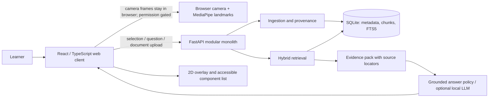

# System architecture

## Context and topology

Initial deployment is one local web client and one local FastAPI process on the learner's computer. SQLite stores document metadata, extracted chunks, FTS5 lexical index, and optional session records. Optional model files live outside source control in a documented local model directory. There is no cloud dependency, hosted inference, telemetry service, or separate microservice.

## Components and responsibility boundaries

- **Web client:** webcam permission/lifecycle, frame throttling, canvas/SVG overlays, selection UX, accessible pointer fallback, citations, question and quiz display. The M3 prototype displays camera frames locally only; it does not upload or record them. Its diagram overlay is manually aligned, not automatically tracked.
- **Browser vision adapter:** hand landmarks through MediaPipe when available; camera capture remains separate from backend. Detector adapters may run local inference in browser or backend later, selected by measured performance and license review.
- **API:** validation, orchestration, error mapping, document and session endpoints. It does not own model training.
- **Ingestion:** file validation, text extraction, page-aware segmentation, content hashes, incremental indexing and deletion.
- **Retrieval:** SQLite FTS5 BM25 first; optional local embedding model and vector index; reciprocal-rank fusion; provenance-preserving results.
- **Tutor:** evidence pack only, explicit abstention, citation allow-list and response schema. If no suitable local model fits, return ranked evidence plus templated explanation.
- **Training/evaluation workspace:** separate scripts/notebooks and versioned manifests; candidate artifacts are evaluated before any inference adapter changes.

## Data flow

1. User selects a PDF. API applies size/type/signature/page limits and safe parser settings, hashes it, extracts per-page text and section clues, then records source spans.
2. Chunk records and FTS rows are written transactionally. Optional embeddings are generated locally and associated by stable chunk ID.
3. UI supplies selected concept plus question. Retrieval runs lexical and (when installed) dense search; results are fused and deduplicated.
4. Citation records are constructed from stored provenance, not generated by the LLM. Prompt injection in retrieved text is treated as untrusted data.
5. Answer policy returns answer, evidence IDs, uncertainty/abstention, and next question. Server validates evidence IDs against retrieved set before response.

## Vision and spatial behavior

For MVP, use a static supported diagram with predefined regions or user-confirmed 2D regions. A browser overlay uses the same normalized image/video coordinate space as its source, with explicit transforms for `object-fit`, crop, mirroring, and device pixel ratio. On camera movement, target loss, or occlusion, hide or mark the overlay stale and require re-detection/reconfirmation. Never claim world coordinates or physical distance from a monocular webcam. Gesture pointing is a convenience; click/touch/list fallback remains available.

The current M3 prototype implements this fallback with manual translation/scale/rotation, orientation-change invalidation, and a learner-operated stale/reconfirm control. It does not automatically observe camera motion, target loss, or occlusion; automatic detection remains future work and the learner must mark the alignment stale when the page or camera moves or the page is covered.

## Reliability and deployment

Single-user local mode starts frontend and backend separately in development; a packaged topology can be decided after the vertical slice. SQLite backups are user-controlled. Migrations must be versioned. Models are downloaded only through documented, user-initiated steps with exact revision and license recorded. Offline operation supports uploaded content and bundled code; model downloads are not assumed available at runtime.

## Future extension seams

Interfaces for `Detector`, `EmbeddingProvider`, `Retriever`, `AnswerGenerator`, and `DocumentExtractor` allow replacement. Multimodal indexing stores image/figure assets and caption/region relationships under the source document's provenance; it is not part of initial text-only RAG.
